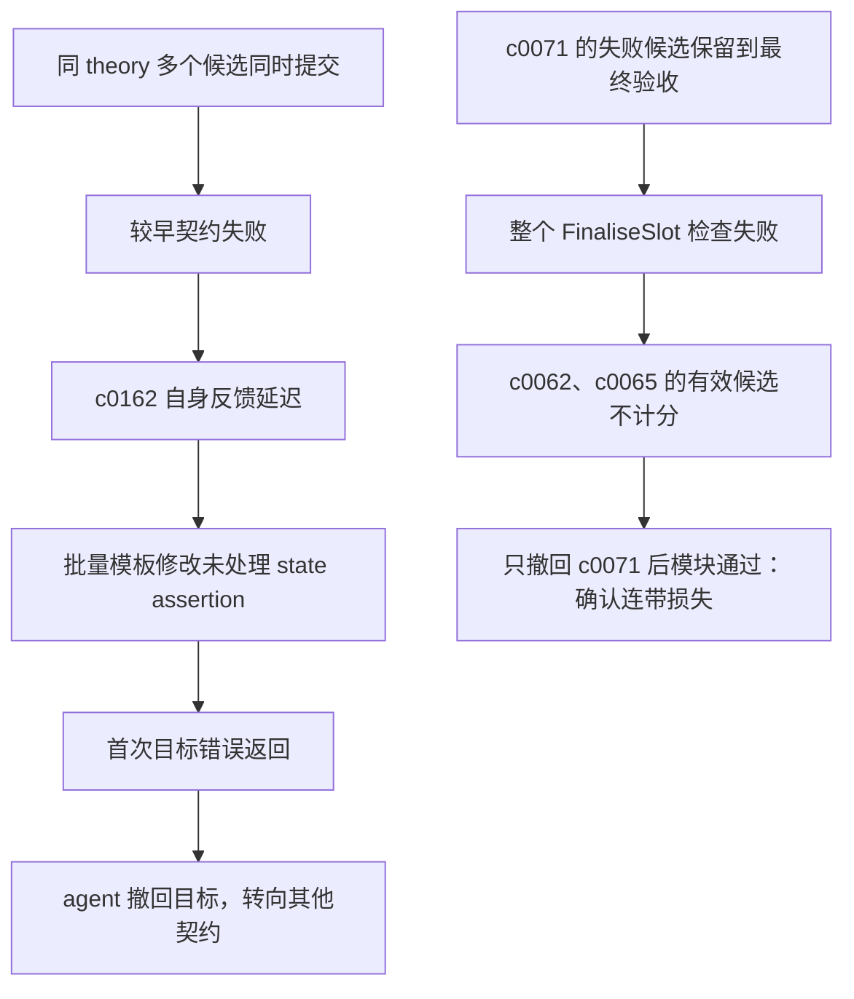

# Vero PLAN 实验的失败归因：隔离重验与修复轨迹

本报告是对原始 **35/287** 实验的事后诊断，不修改原成绩。机器 B 上执行了五次原生 Isabelle 检查，没有调用 LLM、没有生成新证明、没有转移认证凭据。固定 benchmark、命题、上下文、imports、Isabelle、sanitized runtime、父 heap 和 checker 参数沿用原实验；干预内容逐项记录。

## 结论

| 目标 | 观察与控制实验 | 归因 | 证据强度 |
| --- | --- | --- | --- |
| c0062 `arch_postCapDeletion_corres` | 原模块失败；仅撤回 c0071 后，本目标原证明体通过完整模块验收 | 同模块失败导致计分损失 | 已确认 |
| c0065 `deletedIRQHandler_corres` | 同上；保留了对 c0076 的跨模块引用 | 同模块失败导致计分损失；并非跨文件引用不受支持 | 已确认 |
| c0071 `postCapDeletion_corres` | 原样重放仍在自身证明处留下 12 个子目标 | 候选证明未完成；具体检索或策略根因尚未做干预确认 | 直接失败已确认，深层原因待验证 |
| c0162 `setCurThread_corres` | 三种历史候选隔离后均失败，目标含未处理的 state assertion | 证明规则与目标结构不匹配；模块检查延迟反馈，收到目标错误后未继续修复 | 结构性失败及行为轨迹已确认 |

这证实有 **2 项既有证明可以通过隔离失败候选保住**，支持改进候选隔离与验收方式。但没有做新的 287 项全量验收，不能把主实验成绩直接改写为 37/287，也不能据此宣称 lemma 级调度的整体生成效率更高。

## 1. FinaliseSlot：一次单变量干预

### 对照

从最终 artifact 原样渲染，检查 `Vero_FinaliseSlot`。耗时 20.46 秒，结果 `build_error`；c0062、c0065 先产生 clean audit，随后 c0071 报告 12 个未解子目标。原始失败得到重现。

### 干预

唯一改动是将 `c0071:prove` 的候选证明体改成 `oops`。所有其他证明体，包括 c0062、c0065 以及导入模块中的生成证明，完全不变；没有修改 contract 声明、假设和 imports。

重验耗时 20.47 秒，**模块返回 `ok`，c0062、c0065 均有 clean audit**。`oops` 不发布定理，因此此次没有假设 c0071 为真。见 [干预一致性审计](intervention-audit.json)、[对照日志](finalise-original/checker.log)、[隔离日志](finalise-without-c0071/checker.log)。

因果结论限于本次候选：c0071 的失败体确实使另外两个有效候选失去原实验的模块级计分。它们不需要重新生成证明，就能在完整成功的模块检查中被接受。该结果不意味着 c0071 本身已经解决。

## 2. c0162：四次提交不等于四次自身失败

时间相对于原生成任务开始；从候选快照和 checker 日志重建：

| 提交 | 时间 | 候选版本 | 最先报错的契约 | 能否据此判断 c0162 自身失败 |
| --- | ---: | --- | --- | --- |
| 1 | 569.85 秒 | A：`fastforce intro: corres_modify` | c0149，`numDomains_def` 未定义 | 不能 |
| 2 | 590.75 秒 | A，证明体不变 | c0081，自动化未应用成功 | 不能 |
| 3 | 615.46 秒 | B：改为显式 `rule corres_modify` | c0081，剩余 `cdt_relation` 子目标 | 不能 |
| 4 | 633.48 秒 | C：在 B 上增加 `swp_def cte_wp_at_def` | c0162，`rule corres_modify` 未应用成功 | 能，首次目标自身诊断 |
| 撤回后检查 | 649.50 秒 | `oops` | 模块通过 | c0162 无证明，不计分 |

前三次日志中的 sibling 错误不应算成 c0162 的失败原因。尤其不能把 c0081 的 `cdt_relation` 剩余目标移植成 c0162 的根因。

原 agent 先对多个状态更新契约套用同一个证明模板，随后两次对整个文件做字符串替换，改变了 c0162 的候选。这些修改发生在收到 c0162 自身诊断之前。首次收到目标特定错误后，下一次相关编辑直接将其撤回，未观察到针对该错误的新证明尝试。完整证据见 [时间线](c0162-timeline.json)、[读取与编辑事件](context-and-edits.json) 和 `original-statefields-attempts/`。

### 三种候选的隔离重验

保留 c0162 原有声明、上下文和 theory imports；只放入对应历史候选，其他 slots 为 `oops`。该模块没有 PLAN 声明的生成模块 imports，但仍继承 `Vero_Support` 的合法语义环境。本实验移除了其他生成定理，因此属于声明明确的隔离干预，不声称是整个历史文件的精确重放。

三种候选都稳定返回 `build_error`，分别耗时 8.97、8.89、9.01 秒。均没有超时或进程错误。原第四次含其他候选的历史检查与候选 C 隔离检查得到同一类目标结构错误。

它们在展开 `setCurThread_def` 后面对的结构为：

```text
左侧：modify (cur_thread_update ...)
右侧：do
        stateAssert idleThreadNotQueued [];
        modify (ksCurThread_update ...)
      od
```

而 agent 检索到的 `ExtraCorres.corres_modify` 对应的是：

```text
corres ... (modify f) (modify g)
```

因此不能直接把该规则应用到右侧含前置断言的目标。候选 B、C 在 `apply (rule corres_modify)` 处就失败，后续用于状态关系化简的步骤没有执行。候选 C 增加的 `swp_def`、`cte_wp_at_def` 不能解决这个更早的结构不匹配。

这支持“证明策略没有先处理断言”的归因，不能证明所有断言义务都容易完成，也不能据此宣称找到一条辅助定理就一定能证明目标。

## 3. 上下文、反馈、预算分别起了什么作用？

### 上下文与检索

- 原始事件第 15 行的搜索输出已经给出 `state_relation_def` 和 `ExtraCorres.corres_modify` 的完整陈述。因此不是完全没有可用定义或 correspondence 规则。
- 事后只读检索发现冻结 premise 库中存在 13 条名称含 corres、陈述涉及 stateAssert/state_assert 的记录，包括 `corres_stateAssert_add_assertion`、`corres_stateAssert_implied` 等。见 [目录查询结果](assertion-premise-catalog.json)。
- 在撤回前的可见完成事件输出中，没有发现这些规则的短名；显式 `stateAssert_def` 搜索出现在撤回之后的第 93 行，用于后续其他目标。
- 因此“没有针对目标断言结构继续检索”有轨迹支持。**尚未证明其根因是上下文过长或模型遗忘**；没有做提示长度消融或定向 premise 的 LLM 对照实验。目录命中也不等于原生环境中已验证适用性。

### harness 与反馈

- 模块级检查连续三次先被其他目标阻断，推迟了 c0162 自身诊断。这是可观察到的反馈粒度问题。
- c0162 自身错误最终确实返回到了 agent 的可见工具输出；之后它选择撤回。不能说 harness 从未传回错误。
- 对 c0062、c0065，模块整体成功才能计分的规则造成了已经由控制实验确认的两项损失。
- 本次未更改 harness，也没有测试 lemma 级调度是否能改变模型行为；只验证了失败隔离的直接作用。

### 预算与运行

- c0162 在约 649.50 秒时已经撤回，当时距离 1,800 秒生成预算结束仍约有 **1,150.50 秒（19 分 11 秒）**。这是 agent 的局部取舍，不是该时刻实验已超时。
- 原生成最后在总预算耗尽时被终止；没有收尾修复可能促成最终坏候选残留，但本次尚未做额外修复预算对照，不能确定多给时间的收益。
- 五次原生诊断均正常执行，没有 timeout 或 infrastructure_error；这排除了这些重验中的基础设施故障，不代表原实验全程都不存在网络或延迟问题。

## 4. 因果链与当前结论边界



下一步最有区分力的实验是：固定 c0162 的目标和预算，对比“原反馈”“聚焦断言结构的反馈”“提供已确认可用的断言规则”三种修复输入，再做重复试验。当前没有实施这些模型干预，不将它们的预期收益作为实测结论。

## 复现与清理

- [五组原生结果](summary.json)、[checker 与输入绑定](binding.json)、[挂载与镜像身份](deployment.json)。各案例目录含干预 manifest、源文件和完整 checker 日志。
- 诊断容器网络为 `none`，没有挂载 Codex、认证文件或原始人工证明仓库。使用现有 `Checker` 和 `render`，未引入新的证明判定器。
- [执行脚本](reproduction/check.py)、[部署脚本](reproduction/deploy.py)。部署脚本使用独立目录；复现时应换新的 run 路径和容器名，避免覆盖已有结果。
- 本地完整渲染文件：父工作树 `reports/vero-isabelle-refine-attribution-20260916/`；机器 B：`/data/zljj/vero-runs/refine-attribution-001/`。
- 专用诊断容器已移除，主 `sel4-l4v` 容器仍运行；本轮未使用认证凭据，见 [清理记录](cleanup.json)。
